<picture>
  <source media="(max-width: 640px)" srcset="assets/cover-mobile.svg">
  
</picture>

# 피싱 신호등

**AI가 위험을 찾지 못해도 송금 전에는 한 번 더 묻습니다.**<br>

받은 문자·메시지를 브라우저에서 분석하는 피싱 대응 서비스입니다.<br>
송금·정보 전달·앱 설치를 요구받았는지 사용자에게 다시 확인합니다.<br>
이미 행동했다면 AI 분석을 기다리지 않고 피해 대응 방법부터 안내합니다.<br>

**1인 개발** · 기획 · UI 설계 · 모델 학습 · 웹 구현 · 배포

**[직접 체험하기 ↗](https://www.phishing-signal.site/check)** · [서비스 소개](https://www.phishing-signal.site/) · [신뢰와 데이터](https://www.phishing-signal.site/trust) · [검증 결과와 한계](docs/evaluation.md)

<br>

> **분석 방식과 첫 실행 안내**<br>
> 입력한 문자·메시지는 외부 AI 서버로 보내지 않고 사용자의 브라우저에서 분석합니다.<br>
> 첫 분석에는 약 **223MB 모델 다운로드와 준비 시간**이 필요하며 기기와 네트워크에 따라 시간이 달라집니다.<br>
> 같은 탭에서 다시 분석할 때는 준비된 모델을 재사용합니다.<br>


[체험 순서와 예시 문구 ↓](#직접-체험해-보세요)

<br><br>

## 연락에서 다음 행동까지

<picture>
  <source media="(max-width: 640px)" srcset="assets/decision-flow-mobile.svg">
  
</picture>

*설명용 흐름도입니다.<br>
Safe 경로를 읽는 순서에 맞춰 움직임을 넣었습니다.<br>
실제 처리 시간이나 진행률을 뜻하지 않습니다.*<br>

이미 송금·정보 전달·앱 설치를 했다면 **긴급 대응**에서 현재 상황을 선택합니다.<br>
원문 입력이나 AI 분석 완료 없이 대응 순서를 확인할 수 있습니다.<br>

배송 안내 예시를 분석한 뒤 “**모르겠어요**”를 선택하면, 모델 라벨은 그대로 두고 행동을 보류한 채 공식 경로로 확인하도록 안내합니다.<br>
규칙으로 찾은 참고 표현을 원문에 표시합니다.<br>
모델 내부의 판단 이유와 구분합니다.<br>

[판정 조건과 예외 처리 →](docs/architecture.md) · [행동 확인 도식과 실제 시연 화면 →](docs/demo.md#2-뚜렷한-위험이-없어도-행동-확인)

<br><br>

## 연락은 기기에, 분석 도구는 브라우저로

<picture>
  <source media="(max-width: 640px)" srcset="assets/browser-architecture-mobile.svg">
  
</picture>

*처리 위치와 통신 범위를 설명하는 개념도입니다.<br>
움직임은 실제 실행 시간이나 모든 요청을 나타내지 않습니다.*<br>

연락 원문과 행동 확인 답변은 기본 분석 경로에서 외부 AI 추론 API로 보내지 않습니다.<br>
모델·토크나이저·실행 파일 다운로드, 사례 조회·참여, 이용 통계에는 네트워크 통신이 있습니다.<br>

모델 준비·추론은 Worker로 분리하고 같은 탭에서는 준비된 실행기를 재사용합니다.<br>
첫 다운로드와 사용자 기기의 연산·메모리 부담은 남습니다.<br>

[브라우저 실행과 실패 처리 →](docs/architecture.md#3-브라우저-추론과-실패-처리) · [통신·저장 범위 →](docs/architecture.md#4-네트워크와-개인정보-처리의-범위)

<br><br>

## 세 가지 설계 결정

### 1. Safe 이후에도 실제 행동 요구를 확인합니다

한국어 문맥 모델이 Safe로 분류하면 엄격한 규칙으로 입력을 다시 살핍니다.<br>
근거가 있을 때만 Hold로 보정합니다.<br>
그래도 Safe라면 실제 행동 요구를 사용자에게 묻습니다.<br>
“있어요”, “모르겠어요”, 미응답이면 행동 보류를 안내하고 “없어요”를 고르면 위험 신호 미확인으로 표시합니다.<br>
발신자나 거래의 안전을 인증하는 결과는 아닙니다.<br>

### 2. 이미 행동했다면 AI보다 대응이 먼저입니다

송금·앱 설치·개인정보 전달 여부에 따라 대응 순서를 안내합니다.<br>
모델이 로딩 중이거나 연락 원문이 없어도 이용할 수 있으며 분석 실패도 별도의 “분석 불가”로 구분합니다.<br>

### 3. 민감한 연락은 내 브라우저에서 분석합니다

KLUE RoBERTa-base를 피싱 문맥에 맞게 파인튜닝하고 ONNX로 변환해 브라우저에서 실행합니다.<br>
분석 원문을 외부 AI 추론 API로 보내지 않습니다.<br>
첫 실행에는 약 223MB 모델 다운로드가 필요하며 모델 다운로드·사례 조회·방문 분석 등 네트워크 통신은 있습니다.<br>

<br>

## 직접 체험해 보세요

[연락 확인](https://www.phishing-signal.site/check)에서 화면의 예시 버튼을 선택하거나 아래 문구를 붙여넣고 **위험 신호 확인하기**를 누릅니다.<br>
예시 버튼이 보이지 않는 화면에서도 같은 문구로 체험할 수 있습니다.<br>

서비스가 하는 일은 [서비스 소개](https://www.phishing-signal.site/)에서, 원문 처리와 통신 범위는 [신뢰와 데이터](https://www.phishing-signal.site/trust)에서 살펴볼 수 있습니다.<br>

메인 페이지에서는 짧은 브랜드 인트로를 보여줍니다.<br>
연락 확인에 처음 들어가면 사용 안내가 열리고 끝까지 보거나 건너뛴 기록은 브라우저에 저장합니다.<br>
긴급 대응 링크로 바로 들어갈 때는 안내를 거치지 않습니다.<br>

**1. 검찰 사칭 — 위험한 요구를 확인합니다.**<br>

```text
서울중앙지검 금융수사팀입니다. 자산 보호를 위해 지금 안전계좌로 송금하고 OTP 인증번호를 알려주세요.
```

위험 안내와 원문에서 다시 확인할 참고 표현을 살펴봅니다.<br>

<br>

**2. 배송 안내 — AI 판정 이후의 행동 확인을 봅니다.**<br>

```text
배송이 완료되었습니다. 자세한 배송 내역은 택배사 공식 앱에서 확인해 주세요.
```

피해 상황을 선택하지 않은 상태에서 분석한 뒤 **모르겠어요**를 선택합니다.<br>
송금·정보 전달·앱 설치를 보류하고 공식 경로로 확인하도록 안내하는 흐름을 볼 수 있습니다.<br>

<br>

**3. [긴급 대응](https://www.phishing-signal.site/check?screen=incident) — 연락 분석 없이 대응 순서를 확인합니다.**<br>

이미 한 행동을 선택하고 **대응 보기**를 누릅니다.<br>
시연 중 실제 전화·신고 버튼을 누를 필요는 없습니다.<br>

위 문구는 제품에 넣어 둔 합성 예시이며 성능 평가 표본이 아닙니다.<br>
[시연 가이드·실제 화면·측정 조건 →](docs/demo.md)

<br><br>

## 연구가 제품의 결정으로 이어진 과정

규칙 기반 탐지부터 시작해 여러 한국어 모델과 결합 방식을 비교했습니다.<br>
**위험 단어가 등장하는 것과 실제 위험 행동을 요구하는 것은 다르다**는 문제도 이 과정에서 확인했습니다.<br>
사용자가 붙여 넣을 연락과 설명·보고 형식의 학습 문장을 구분할 필요도 있었습니다.<br>

<br>

데이터의 문맥과 라벨 기준을 다시 보고 C3 v2를 학습했습니다.<br>
모델 판정에 제한된 규칙 보정과 행동 질문을 연결하고 정보 부족·분석 실패·피해 대응을 구분해 처리했습니다.<br>
[데이터·모델·제품 구성을 바꾼 과정 →](docs/journey.md)

<br>

구현에서도 **분석이 끝나기 전에 긴급 대응을 이용할 수 있어야 한다**는 조건을 두었습니다.<br>
모델 준비·추론은 Worker로 옮기고 대응 화면은 분석 결과와 별도로 동작하게 했습니다.<br>
[문제·선택·확인 결과를 정리한 구현 사례 →](docs/journey.md#구현-사례-ai를-기다리지-않는-긴급-대응)

<br><br>

## 서비스 소개와 신뢰 안내

2026년 10월 10일 기준, 서비스 소개는 **받은 연락 → 위험 신호 → 다음 행동**의 순서로 구성했습니다.<br>
신뢰와 데이터에서는 연락 원문을 기기 안에 두고 분석 모델을 내려받는 과정을 보여줍니다.<br>
두 화면의 장면은 설명용 예시이며 실제 분석 결과와 구분합니다.<br>

‘연결과 기록’에서는 궁금한 항목을 골라 처리 기준을 읽을 수 있습니다.<br>

| 항목 | 확인할 내용 |
|---|---|
| 연락과 답변 | 원문과 행동 확인 답변의 분석 위치, 화면에 유지하는 범위 |
| 분석 도구 | 약 223MB 모델 다운로드, 파일 검사, 준비·실패 안내 |
| 사례와 참여 | 공유 사례 조회와 ‘나도 받았어요’ 참여에 필요한 통신 |
| 브라우저 기록 | 사용 안내를 본 기록과 모델 캐시 |

모바일에서는 항목을 한 줄로 넘겨 고르고 상세 설명은 짧은 소제목과 문단으로 나눴습니다.<br>
모델·데이터·평가 결과를 바꾼 작업은 아닙니다.<br>

[화면 구성과 확인 범위 →](docs/branding.md) · [통신·저장 범위 자세히 보기 →](docs/architecture.md#4-네트워크와-개인정보-처리의-범위)

<br><br>

## 검증 결과와 한계

초기 검증 225개, Gold v2 144개, 새 기준 205개, 현재 배포 모델의 최신 고정 205개 평가를 순서대로 담았습니다.<br>
각 구역에 당시 평가셋과 모델별 정답률을 함께 표시했습니다.<br>
Macro F1과 세부 지표는 [평가 문서](docs/evaluation.md)에 남겼습니다.<br>

<picture>
  <source media="(max-width: 640px)" srcset="assets/runtime-profile-mobile.svg">
  
</picture>

데이터셋의 구성과 정답 기준을 다시 정리하며 모델을 개선했습니다.<br>
평가셋이 다른 점수는 성능 향상률로 연결하지 않으며, 현재 피싱 판정 성능은 사전에 정한 안전 기준을 아직 충족하지 못했습니다.<br>

브라우저 실행과 응답 시간은 판정 성능과 별도로 확인했습니다.<br>

| 확인한 결과 | 해석 범위 |
|---|---|
| 개발 입력 450/450에서 브라우저 실행 판정 일치 | 모델 변환·실행의 일치성 검사이며 피싱 탐지 정확도 100%를 뜻하지 않습니다.<br> |
| 첫 분석 29.94초 · 같은 탭 후속 분석 1.01초 | 한 데스크톱 환경에서 측정한 단일 관측값입니다.<br> |

[데이터셋별 평가 조건·전체 모델 비교·현재 모델의 한계 →](docs/evaluation.md)

<br><br>

## 기술 스택

| 영역 | 기술과 역할 |
|---|---|
| 제품 | Next.js 16.3.3 · React 19.2.8 · TypeScript 6.0.3 |
| 모델 | KLUE RoBERTa-base 파인튜닝 · PyTorch · ONNX |
| 브라우저 추론 | ONNX Runtime Web 1.29.0 · WASM · Web Worker |
| 배포 | Vercel — 웹앱 / Cloudflare R2 — 모델 파일 |
| 사례 조회 | Supabase — 현재 제품의 사례 동향 조회 |

모델 배포 비용과 사용자 기기의 다운로드·연산 부담은 남습니다.<br>
현재 새 분석 결과의 사례 공유는 꺼져 있고 사용자 입력을 학습 데이터로 자동 수집하지 않습니다.<br>

<br>

## 개발에 활용한 AI

ChatGPT/Codex는 제품 구현, 회귀 검증, 기록 정리, 문서화에 사용했습니다.<br>
표지와 설명 도식은 기존 브랜드 표현을 바탕으로 SVG로 구성했습니다.<br>
사용자의 연락을 분류하는 AI는 별도로 파인튜닝한 RoBERTa 모델입니다.<br>
대화형 AI의 답변을 서비스 판정으로 그대로 쓰지 않습니다.<br>

<br>

## 다음 검증과 확장

이제 **실제 휴대전화 성능, 첫 다운로드 부담, 독립적인 현장 평가**를 확인해야 합니다.<br>
가족이 함께 확인하는 흐름이나 상담 현장 보조 도구로 넓힐 수 있는지도 살펴볼 계획입니다.<br>
아직 제공하는 기능이나 확인된 사용자 성과는 아닙니다.<br>

<br>

## 이 공개 저장소에 담긴 것

이 저장소에는 제품 소개, 설계 설명, 평가 집계, 실제 화면만 담았습니다.<br>
운영 코드·연구 원문·학습 및 평가 데이터·모델 바이너리·비공개 Git 이력은 없습니다.<br>
전체 학습·평가를 재현할 수 있는 오픈소스 배포판은 아닙니다.<br>

2026년 10월 30일 운영 저장소의 `main` 코드와 기존 평가 기록을 기준으로 공개 문서·도식을 다시 대조했습니다.<br>

- [제품 판단 구조](docs/architecture.md)
- [평가 결과·실행물 식별·알려진 한계](docs/evaluation.md)
- [연구에서 제품으로 이어진 결정](docs/journey.md)
- [직접 체험할 시연 가이드](docs/demo.md)
- [서비스 소개와 데이터 안내의 화면 설계](docs/branding.md)
- [모델·기술 출처와 라이선스](docs/attribution.md)

연락 분석은 참고 정보입니다.<br>
금전·인증정보·앱 설치를 요구받았다면 상대가 제공한 경로와 별개로 알고 있던 공식 경로에서 확인하세요.<br>
