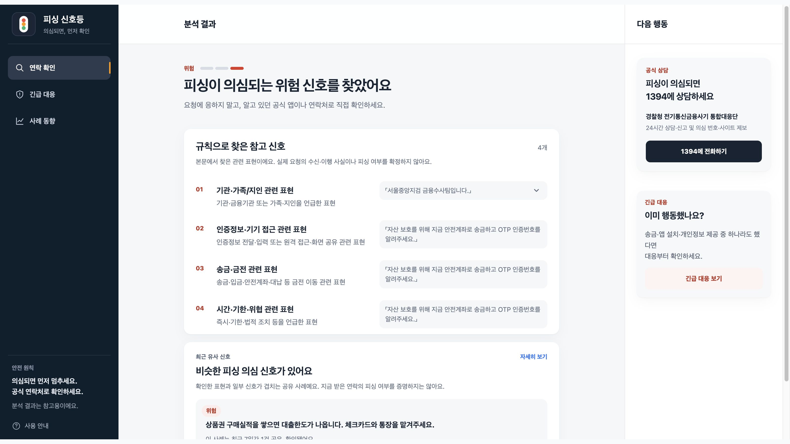
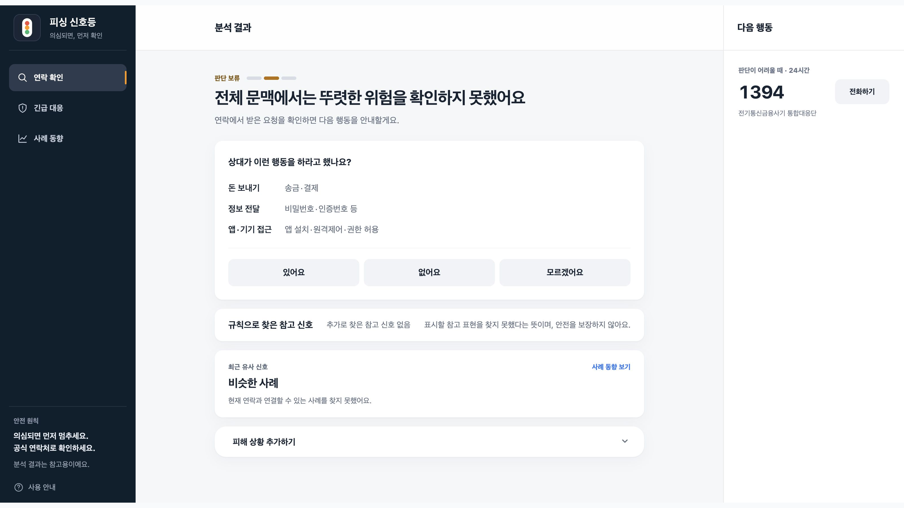
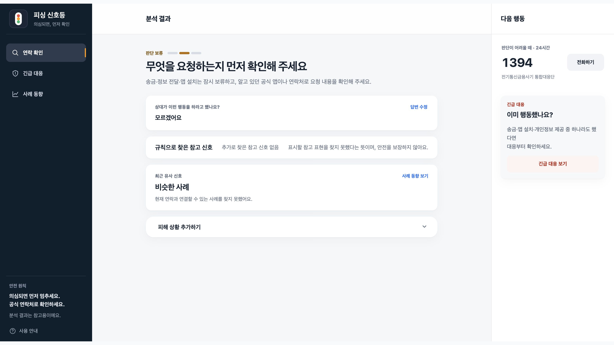
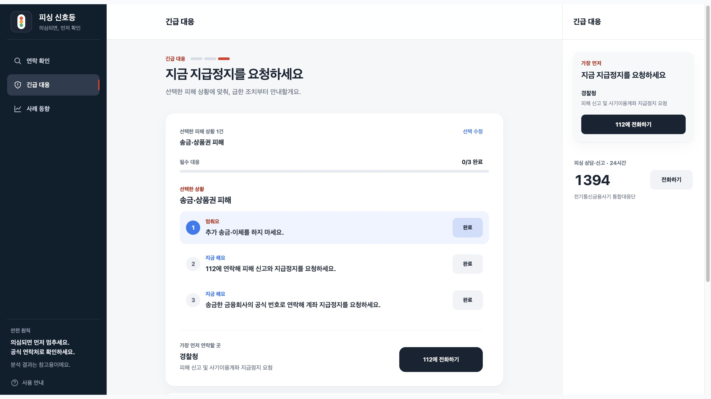

# 직접 체험하기

[← 제품 소개](../README.md) · [연락 확인 열기](https://www.phishing-signal.site/check)

가입 없이 웹에서 체험할 수 있습니다.<br>
첫 분석에는 약 223MB 모델을 다운로드하므로 네트워크와 기기에 따라 시간이 걸립니다.<br>
9월 20일 한 데스크톱 환경에서는 첫 분석 약 30초, 같은 탭 후속 분석 약 1초가 관측됐습니다.<br>
걸리는 시간은 사용 환경에 따라 달라집니다.<br>

홈페이지 첫 화면은 [서비스 소개](https://www.phishing-signal.site/)입니다.<br>
원문의 처리 범위와 필요한 통신은 [신뢰와 데이터](https://www.phishing-signal.site/trust)에서 확인할 수 있습니다.<br>

메인 페이지의 짧은 인트로와 연락 확인의 사용 안내는 별개입니다.<br>
연락 확인에 처음 들어가면 사용 안내가 열립니다.<br>
안내를 마치거나 건너뛰면 브라우저에 기록을 남기고 이후에는 필요할 때 직접 다시 열 수 있습니다.<br>
[긴급 대응](https://www.phishing-signal.site/check?screen=incident)으로 바로 들어가면 안내를 거치지 않습니다.<br>

<br>

## 1. 위험한 요구 확인

연락 확인 화면에서 **검찰 사칭 예시**를 선택한 뒤 **위험 신호 확인하기**를 누릅니다.<br>
화면 너비에 따라 예시 버튼이 보이지 않을 때는 아래 문구를 입력란에 붙여넣어 분석할 수 있습니다.<br>

```text
서울중앙지검 금융수사팀입니다. 자산 보호를 위해 지금 안전계좌로 송금하고 OTP 인증번호를 알려주세요.
```

이 문구는 제품에 넣어 둔 합성 예시이며 실제 연락을 수집한 자료가 아닙니다.<br>
촬영 화면에서 위험 안내와 규칙으로 찾은 참고 표현을 확인했습니다.<br>
참고 표현은 모델 내부의 판단 이유를 설명하지 않습니다.<br>



<br><br>

## 2. 뚜렷한 위험이 없어도 행동 확인

피해 상황을 선택하지 않은 상태에서 다시 연락 확인으로 돌아갑니다.<br>
**배송 안내 예시**를 선택하거나 아래 문구를 붙여넣고 분석합니다.<br>

```text
배송이 완료되었습니다. 자세한 배송 내역은 택배사 공식 앱에서 확인해 주세요.
```

촬영한 화면에는 모델의 Safe 판정 뒤에 **송금·정보 전달·앱 접근 요구를 받았는지** 묻는 질문이 나타납니다.<br>
“모르겠어요”를 선택하면 행동을 보류하고 공식 경로에서 확인하도록 안내합니다.<br>
이 답으로 모델 라벨을 새로 예측하지는 않습니다.<br>

<picture>
  <source media="(max-width: 640px)" srcset="../assets/action-check-mobile.svg">
  
</picture>

*설명용 도식입니다.<br>
아래 PNG는 실제 운영 화면을 촬영한 기록입니다.*<br>





<br><br>

## 3. 연락 분석 없이 긴급 대응

[긴급 대응](https://www.phishing-signal.site/check?screen=incident)에서 “돈을 보내거나 상품권 코드를 알려줬어요”를 선택하고 **선택한 1건 대응 보기**를 누릅니다.<br>
선택한 상황에 따른 대응 순서를 볼 수 있습니다.<br>
시연 중에는 실제 전화·신고 버튼을 누를 필요가 없습니다.<br>



<br><br>

## 촬영과 검증 범위

### 실제 운영 화면 캡처

이 가이드의 실제 화면 캡처는 2026년 9월 20일 기록입니다.<br>
2026년 10월 10일까지 바뀐 서비스 소개·신뢰 화면과 첫 방문 안내는 담지 않았습니다.<br>
보관한 캡처에 남은 사례 공유 안내는 촬영 당시 문구입니다.<br>
현재 운영 모델의 새 분석 결과 공유는 비활성화되어 있습니다.<br>
현재 화면 구성은 [화면 설계 문서](branding.md)에 따로 정리했습니다.<br>

- 촬영: 2026.09.20, 공개 운영 서비스, 데스크톱 Chromium에서 실제 페이지의 1600×900 배치를 2배로 렌더링했습니다.<br>
  제출 출력은 모두 3200×1800(16:9) PNG입니다.<br><br>
- 내장 합성 예시와 시연용 피해 상황 선택만 사용했습니다.<br>
  개인의 실제 연락·피해 정보는 포함하지 않았습니다.<br><br>
- 결과 문구를 편집하거나 미구현 기능을 덧그리지 않았습니다.<br>
  캡처 도구가 제외한 가장자리만 바깥 여백으로 채워 16:9 비율을 맞췄습니다.<br>
  원본 캡처 픽셀은 리사이즈·색 보정 없이 보존했습니다.<br><br>
- assets에 보관한 화면 5장(`01`부터 `05`까지)은 실제 운영 화면 캡처입니다.<br>

### 표지와 설명용 도식

2026년 10월 30일, 공개 README의 도식을 같은 색상·글꼴·여백으로 정리하고 모바일용 세로 구성을 추가했습니다.<br>
제품 코드·모델·평가 결과는 변경하지 않았습니다.<br>

- [표지](../assets/cover.svg)에는 기존 신호등 심벌과 서비스 문구를 벡터로 넣었습니다.<br>
  심벌이 한 번 회전한 뒤 위아래로 천천히 움직이고, 빨강·노랑·초록 렌즈가 차례로 밝아지는 모션을 반복합니다.<br>
  문구는 고정하며 실제 판정 결과를 나타내지 않습니다.<br>
- [연락에서 다음 행동까지](../assets/decision-flow.svg)에서는 연락 분석과 긴급 대응을 독립된 경로로 나눴습니다.<br>
  Safe 경로의 연결선과 화살표를 순서대로 강조합니다.<br>
  화살표가 도착하면 다음 카드가 짧게 밝아졌다 제자리로 돌아옵니다.<br>
- [브라우저 아키텍처](../assets/browser-architecture.svg)는 모델 다운로드, 브라우저 내부 분석, 사례·이용 통계의 별도 통신을 구분합니다.<br>
  모델 다운로드는 한 번 강조하고, 브라우저 내부 입력·결과 방향은 순서대로 반복합니다.<br>
  사례·통계는 분석과 별도 통신으로 구분합니다.<br>
  실제 시간이나 모든 요청을 나타내지 않습니다.<br>
- [데이터셋별 모델 평가](../assets/runtime-profile.svg)는 초기 검증 225개, Gold v2 144개, 새 기준 205개, 현재 배포 모델의 최신 고정 205개를 구역별로 나눕니다.<br>
  같은 평가셋의 모델별 정답률은 막대그래프로 비교하고, 현재 모델의 정답률은 별도 카드에 담았습니다.<br>
  수치와 막대 길이는 고정하고, 강조 배경만 01·02·03 순서로 채운 뒤 현재 점수를 한 번 강조합니다.<br>
  평가 조건과 오류 상세는 [평가 문서](evaluation.md), 첫 분석과 후속 분석 시간은 [실행 기록](evaluation.md#3-실제-서비스-실행-확인)에 정리했습니다.<br>
- 이 문서의 [행동 확인 도식](../assets/action-check.svg)에서는 ‘모르겠어요’를 선택하는 부분, 연결선, 행동 안내의 테두리를 순서대로 강조합니다.<br>
  본문과 모델 라벨은 움직이거나 바뀌지 않습니다.<br>

모든 도식은 스크립트나 외부 이미지·글꼴 파일 없이 동작하며 모션 감소 설정에서는 완성 상태로 읽을 수 있습니다.<br>
설명용 도식은 실제 모델 결과를 재생하는 영상이 아니며 실제 운영 화면은 위의 PNG로 보존했습니다.<br>

### 검증 범위

- 이 시연은 알려진 예시의 기능 확인입니다.<br>
  독립 성능 평가나 실사용자 피해 예방 효과의 증거가 아닙니다.<br><br>
- 휴대전화 실기기 성능 검증은 포함하지 않습니다.<br>
